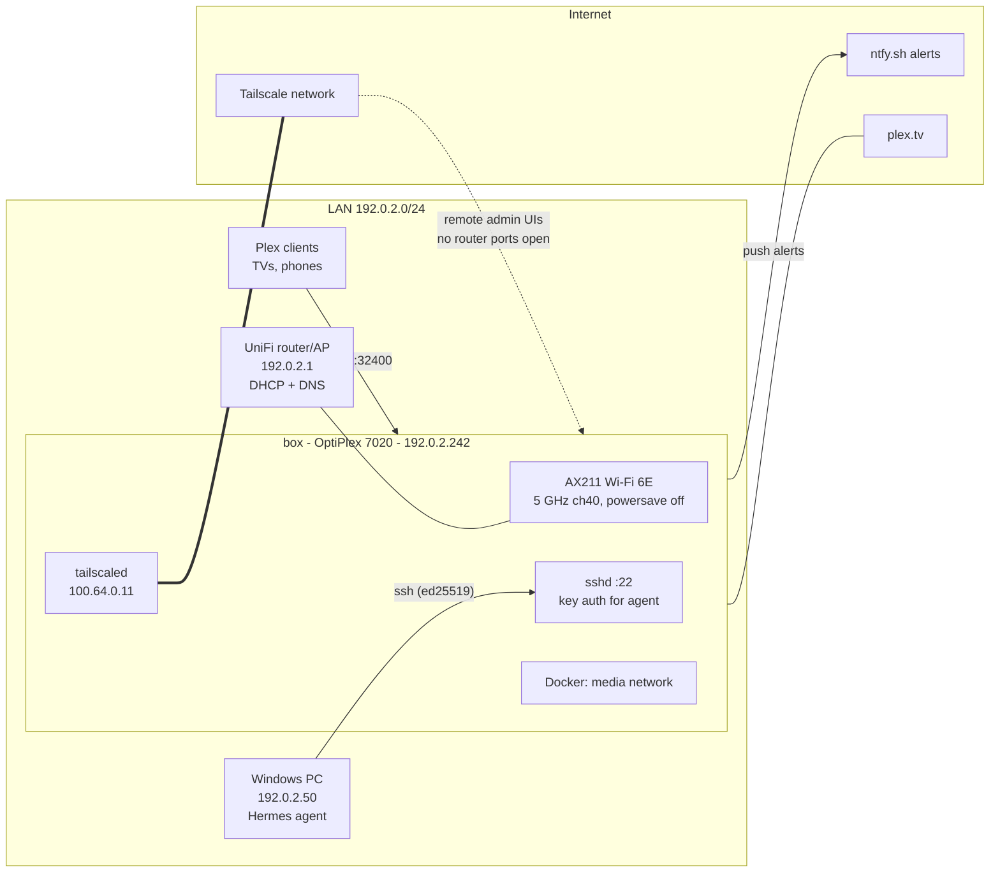
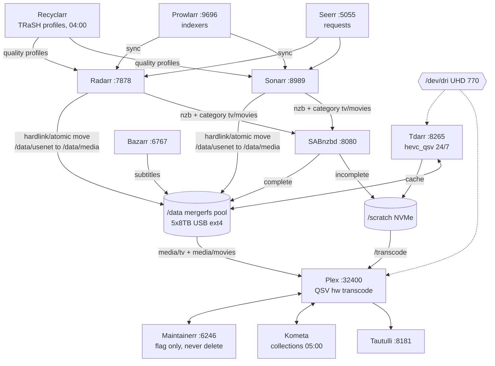
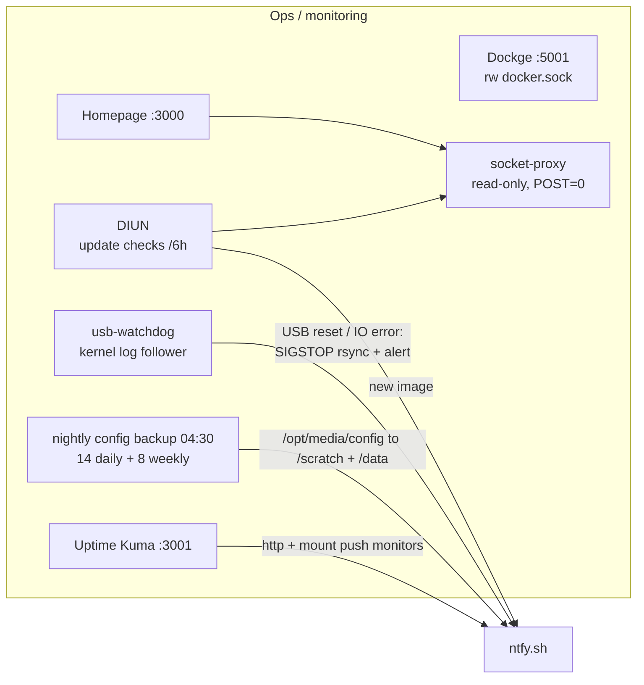

> **Public, scrubbed copy.** IP addresses, MAC addresses, Wi-Fi name, disk serials, UUIDs, Tailscale names, usernames, IDs and all media titles are replaced with placeholders (e.g. `192.0.2.10`, `Show 07`, `Movie 042`). Secrets were never in the repo. Generated automatically from a private repo after every change.

# box — Home Media Server

Dell OptiPlex running a fully containerized Plex + *arr stack on Ubuntu Server, built incrementally with [Hermes](https://hermes-agent.nousresearch.com) doing the driving and every destructive step gated behind explicit human approval.

> **Status (2026-11-08):** all 21 containers running; media apps configured and wired but started **without `/data`** (no-data overrides) until the pool exists. NTFS → ext4 storage migration in progress (round 2 of 5, live progress tile on Homepage).

## Hardware

| Component | Detail |
|---|---|
| Machine | Dell **OptiPlex Micro Plus 7020**, BIOS 1.3.1 |
| CPU | Intel **Core i5-14500** — 14C/20T (6P+8E), up to 5.0 GHz |
| GPU | Intel **UHD Graphics 770** (iGPU, Gen12 Xe-LP) — Quick Sync: H.264 + HEVC 8/10-bit **encode+decode**, AV1 **decode only** (verified via vainfo) |
| RAM | 32 GB |
| OS disk | Crucial P3 500 GB NVMe (`nvme1n1`, serial …XXXX) — LVM, root grown to 300 G |
| Scratch disk | Crucial P3 500 GB NVMe (`nvme0n1`, serial …XXXX) — ext4, `/scratch` (SAB incomplete, Tdarr cache, Plex transcode, config backups) |
| Media storage | 5 × **Seagate 8 TB** in a single USB 3.0 enclosure (JMicron JMS567 bridge, BOT, ~400 MB/s shared): 2 × IronWolf ST8000VN004 (CMR), 3 × BarraCuda ST8000DM004 (SMR). **Planned (Nov 10):** second identical enclosure with 5 × WD80EMAZ 8 TB (CMR) → 8 data + 2 parity |
| Network | Intel **AX211** Wi-Fi 6E — 5 GHz ch 40, 80 MHz, ~720/612 Mb/s PHY. Ethernet (I219-LM) present but no cable run. |

## OS & platform

| Layer | Version |
|---|---|
| Ubuntu Server | 26.04.1 LTS (kernel 7.0.0-30-generic) |
| Docker CE / Compose | 29.9.3 / v5.7.0 (Docker apt repo — not snap) |
| Tailscale | 1.104.5 (host install; zero forwarded ports) |
| ntfsck (ntfsprogs-plus) | 1.0.0, built from upstream source into /usr/local |
| smartmontools | 7.5 |
| mergerfs / SnapRAID | planned: 2.40.2 / 13.0 (installed at pool creation) |

## Application stack

All containers; linuxserver.io images where they exist, official elsewhere. PUID/PGID 1000, TZ Region/City, `restart: unless-stopped`, one shared `media` Docker network (Plex on host networking).

| App | Image | Port | Role |
|---|---|---|---|
| Plex | lscr.io/linuxserver/plex | 32400 (host net) | streaming; `/dev/dri` QSV transcode, temp on `/scratch` |
| Sonarr / Radarr | lscr.io/linuxserver/{sonarr,radarr} | 8989 / 7878 | TV / movie automation (hardlinks, atomic moves on `/data`) |
| Bazarr | lscr.io/linuxserver/bazarr | 6767 | subtitles |
| SABnzbd | lscr.io/linuxserver/sabnzbd | 8080 | usenet client — incomplete on NVMe, complete on pool |
| Prowlarr | lscr.io/linuxserver/prowlarr | 9696 | indexer manager, full sync to the arrs |
| Recyclarr | ghcr.io/recyclarr/recyclarr:8 | — | TRaSH Guides profiles (WEB-1080p / HD Bluray+WEB), x265-HD penalty removed, daily sync |
| Tdarr + node | ghcr.io/haveagitgat/tdarr{,_node} | 8265/8266 | hevc_qsv re-encode, **24/7**, 2 GPU workers, cache on `/scratch` |
| Seerr | ghcr.io/seerr-team/seerr | 5055 | requests (merged Overseerr/Jellyseerr) |
| Tautulli | lscr.io/linuxserver/tautulli | 8181 | Plex stats |
| Kometa | lscr.io/linuxserver/kometa | — | collections/posters, daily 05:00 |
| Maintainerr | ghcr.io/maintainerr/maintainerr | 6246 | flags watched media — **no delete rights, no /data mount** |
| Dockge | louislam/dockge:1 | 5001 | compose UI over `/opt/media/stacks` |
| Uptime Kuma | louislam/uptime-kuma:2 | 3001 | monitoring + USB-mount push monitors |
| Homepage | ghcr.io/gethomepage/homepage | 3000 | dashboard (read-only Docker via socket-proxy) |
| DIUN | crazymax/diun | — | image update notifications (ntfy) — **notify only, no auto-update** |
| socket-proxy | lscr.io/linuxserver/socket-proxy | — | read-only Docker API for Homepage/DIUN (`POST=0`) |
| FileBrowser Quantum | gtstef/filebrowser:stable | 8099 | web file manager; **disk1 read-only** during the migration, the `/data` pool read-write after it |
| What's Up Docker (WUD) | getwud/wud:9 | 3002 | image-update tracker for the Homepage "Updates" tile; read-only socket-proxy, no triggers (**never updates anything**), checks every 6 h. Login required (v9), admin password generated on the box in `ops/wud.env` |
| status | busybox:stable | — (media network only) | serves the Migration / Conversions / self-test tile JSON (`/opt/media/status/*.json`) to Homepage |
| PrismCast (`livetv` stack) | ghcr.io/hjdhjd/prismcast | 5589 web UI, 5004 HDHomeRun tuner, 6080 noVNC (raw VNC 5900 on localhost only) | streaming-service live TV → Plex tuner; logins done by hand in its Chrome via noVNC (`/vnc.html?autoconnect=1&resize=scale`, password in `livetv/livetv.env`) |
| Glances (`glances` stack) | nicolargo/glances:4.5.9-full | 61208 | box CPU / memory / load / temps / disk I/O / network / containers for Home Assistant (glances integration → Origami server pop-up "Media server" graph) and Homepage's Server Room page; `pid: host` + `network_mode: host` (sees wlp0s20f3 / tailscale0), Docker stats via its own loopback-only read-only proxy `glances-socket-proxy` (127.0.0.1:2376, `POST=0`), no data or migration mounts, no state |

## Network / access



**Remote access policy:** everything admin goes over Tailscale; zero port forwards on the router. Plex remote streaming: Tailscale-only for now.

## How the apps interact





## Storage design

```
/data                    mergerfs pool over /mnt/disk1..4 (category.create=mfs, minfreespace=100G)
├── usenet/complete/{tv,movies}     same filesystem as media => hardlinks + atomic moves (TRaSH layout)
└── media/{tv,movies}
/scratch                 NVMe: SAB incomplete, Tdarr cache, Plex transcode, config backups, safekeep
/mnt/diskN               ext4 by-UUID, nofail, chattr +i mountpoints (a missing disk can never fill /)
```

Safety rails: Plex auto-empty-trash off + media deletion off; Maintainerr has no filesystem access; SnapRAID (planned, IronWolf parity) skips sync on mass deletions; Docker is ordered after the mounts; Uptime Kuma push monitors fire if a mount vanishes.

## Migration (in progress)

28 TB of existing media is being moved from NTFS to ext4 **in place** — no spare hardware — by emptying one disk at a time onto the others, checksum-verifying every file (`rsync -rc`), and only then formatting the source, each format behind a separate human OK. Full procedure: [docs/MIGRATION-PLAN.md](docs/MIGRATION-PLAN.md). Live log: [docs/PHASE4-LOG.md](docs/PHASE4-LOG.md).

## Repo layout

This repo mirrors the live box. It is refreshed by `tools/sync-from-box.sh` after every change, so what is here is what is running.

| Path | Contents |
|---|---|
| `stacks/<stack>/` | `compose.yaml`, the temporary `compose.nodata.yaml` overrides, and `env.example` (keys only, secret values replaced) |
| `dockge/` | Dockge's own compose |
| `config/` | app config that is plain text: Homepage, FileBrowser, Recyclarr (keys via `!secret`), Kometa (tokens redacted) |
| `scripts-reference/` | `/usr/local/sbin` helpers: backup, usb-watchdog, mount-push, migration runners, migration-status |
| `systemd/` | the box's custom units and timers |
| `host/` | `fstab`, redacted netplan, `snapraid.conf` once it exists |
| `docs/` | build plan, migration plan, switch-over plan, SnapRAID primer, phase log |
| `exports/` | DB/API-held app settings, redacted (table below) |
| `INVENTORY.md` | generated: containers + images, timers, media mounts, host package versions |
| `tools/` | the sync scripts |
| `CHANGELOG.md` | dated record of every change to the box |

`exports/` holds the settings that live in app databases/APIs rather than files, re-exported on every sync with secrets replaced by `<REDACTED>` and volatile fields (timestamps, run stats) dropped:

| App | What is exported |
|---|---|
| Sonarr / Radarr | host, naming, media management, UI, download clients, indexers, quality profiles + definitions, custom formats, root folders, tags, import lists, delay/release profiles, metadata, notifications |
| Prowlarr | indexers, apps (Sonarr/Radarr sync), download clients, tags, app profiles, proxies, host/UI config |
| Bazarr | all settings + language profiles |
| SABnzbd, Tautulli | their ini files as JSON (servers, categories, switches) |
| Seerr | settings.json |
| Plex | server preferences + library definitions (no watch history) |
| Uptime Kuma | monitors, groups, notifications, tags, maintenance windows, status pages |
| Maintainerr | settings, rule groups, rules, exclusions, collections |
| Tdarr | flows, libraries, global settings, node config |

These are a readable record and a restore reference (re-enter or re-import via each app's UI/API); they are not a drop-in database restore. Full binary restores come from the nightly config backup on the box.

Secrets (`.env`, API keys, Wi-Fi credentials, ntfy topic, push tokens) are **not** in this repo. The sync collects only a whitelist of files, redacts known secret fields, then refuses to commit if any secret value from the box's `.env` files or app configs appears anywhere, plus a pattern scan for token formats.
